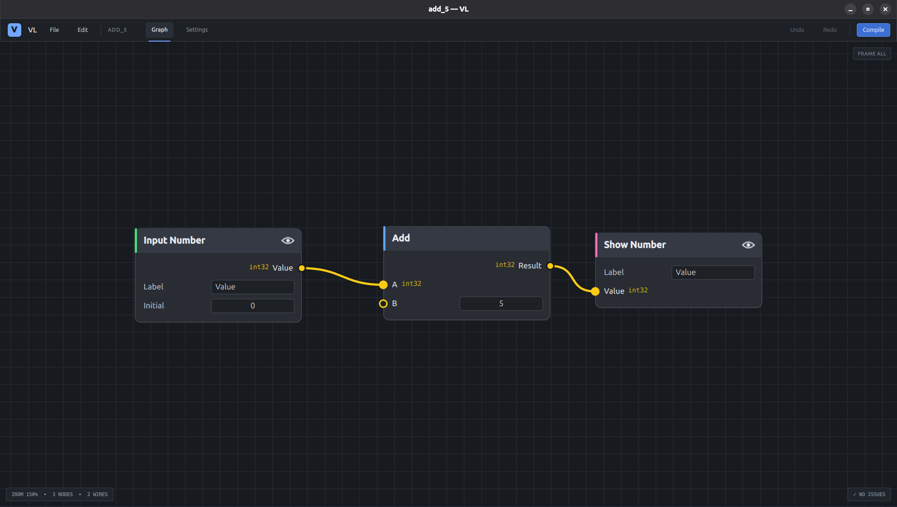

# VL — Visual Language

VL is a visual dataflow programming language. Programs are built as node
graphs, similar to Blender's node editor: nodes have typed inputs and outputs
connected by wires, and incompatible types (e.g. `LidarScan` to `int32`)
can't be connected.



VL is a visual front end for a compiler, not a runtime: the goal is to
translate the graph into C++ (or another compiled language) that runs on the
target hardware.

VL started as a way to program a RoboCars competition robot, so its first
nodes are robotics-oriented, but the language isn't tied to it.

Built with Python, PySide6 and Qt Quick (QML). Linux-first.

## Run on Ubuntu

```bash
sudo apt update
sudo apt install python3 python3-venv
python3 -m venv .venv
source .venv/bin/activate
python -m pip install --upgrade pip
pip install -r requirements.txt
python main.py
```

If creating the virtual environment fails because Ubuntu manages Python packages externally, make sure `python3-venv` is installed and run the commands from your project directory.

## Compiling graphs

**Compile** (Ctrl+B) turns the graph into a C++ project (CMake) in the output
folder and builds it. Building needs a C++ compiler and CMake, plus SDL2 if
any app widget is shown:

```bash
sudo apt install build-essential cmake libsdl2-dev
```

Without them VL still writes the project, and the build log says what to
install. Dear ImGui is downloaded by CMake on the first build.

### Raspberry Pi (Linux ARM64)

Pick **Linux ARM64** as the target. VL cross-compiles with
[Zig](https://ziglang.org) (the `ziglang` package from `requirements.txt`)
and builds SDL2 from source into the program, so nothing else is needed on
this machine besides the packages above. The first ARM64 build takes a few
minutes.

The program runs on 64-bit Raspberry Pi OS (Bookworm or newer) and other
ARM64 Linux systems with glibc 2.34+. Copy it over (e.g. `scp`) and run it.
With the desktop it opens a fullscreen window; without one (Raspberry Pi OS
Lite) it draws straight to the screen, which needs:

```bash
sudo apt install libgbm1 libegl1 libgles2
```

Windows builds need `g++-mingw-w64-x86-64` (untested).

## Current state

Early node editor front end.

- Typed nodes and sockets; only wires between matching types are allowed.
  Feedback loops (including a node feeding itself) are allowed.
- Nodes are defined by JSON files (see `nodes/README.md`), including inline
  fields shown on unconnected inputs and node settings. General nodes are
  built in (`nodes/`); your own nodes are imported into a project with
  File → Import Node… (try `examples/robocars/`)
- Projects are saved as `.vl` files (a zip with the graph, settings and
  imported nodes); startup screen with recent projects
- Settings tab: group and socket type colours, imported nodes
- Issues pill: click an issue to jump to its node
- Undo/redo for adding, deleting, moving, connecting and editing values
- Nodes with an app widget have an eye toggle in their header: whether the
  widget is shown in the compiled app (which lays widgets out automatically)
- Shift+A menu grouped by node group

### Controls

| Action | Input |
|---|---|
| Add node | Shift+A (↑/↓ to move, Enter to open a group or add a node) |
| Select / move | Click / drag a node |
| Toggle in selection | Ctrl+click |
| Box select | Shift+drag on empty canvas |
| Deselect all | Click empty canvas |
| Delete selected | Delete / Backspace |
| Copy / paste / duplicate | Ctrl+C / Ctrl+V / Ctrl+D |
| Undo / redo | Ctrl+Z / Ctrl+Shift+Z or Ctrl+Y (also in the Edit menu) |
| New / open / save / save as | Ctrl+N / Ctrl+O / Ctrl+S / Ctrl+Shift+S |
| Connect | Drag from any socket to a compatible one |
| Move or delete a wire | Drag it off its input; drop on empty canvas to delete |
| Disconnect input | Right-click the input |
| Pan / zoom | Right-drag / mouse wheel |
| Frame all | Home, or the Frame All button |
| Compile options | Ctrl+B, or the Compile button (Enter compiles) |

## Structure

- `main.py` — starts the app: loads the node catalog and QML
- `node_catalog.py` — loads and validates the node JSON files
- `graph_model.py` — nodes, values, typed connections, undo/redo, clipboard
- `project.py` — project files (zip), unsaved changes, recent projects, compile settings, palette, imported nodes
- `palette.json` — default group and socket type colours for new projects
- `examples/robocars/` — importable RoboCars nodes (JSON + C++; LiDAR simulated for now)
- `compiler.py` — compile options, graph checks and C++/CMake code generation
- `builder.py` — runs CMake in the background and collects the build log
- `runtime/vl/` — C++ runtime every compiled program uses (nodes, scheduler, widget window)
- `runtime/cmake/` — cross-compile toolchains (Zig for ARM64) and the SDL2-from-source build
- `nodes/` — built-in node types, one JSON file each
- `ui/Main.qml` — application window: toolbar, File menu, inspector, startup popup, dialogs
- `ui/components/NodeCanvas.qml` — canvas: navigation, wires, selection, clipboard, add-node popup
- `ui/components/Node.qml` — a single node and its rows
- `ui/components/ValueWidget.qml` — inline value editors (number, string, select, checkbox)
- `ui/components/CompilePopup.qml` — compile options popup
- `ui/components/BuildPopup.qml` — build log
- `ui/components/MessageBox.qml` — themed message / confirmation dialog
- `ui/components/SettingsPage.qml` — Settings tab
- `ui/components/ColorPicker.qml` — colour chooser
- `ui/components/Toast.qml` — short fading messages
- `ui/components/ShortcutMenuItem.qml` — menu item with a shortcut hint
- `requirements.txt` — Python dependencies (PySide6, Zig)

## License

MIT — see [LICENSE](LICENSE).
